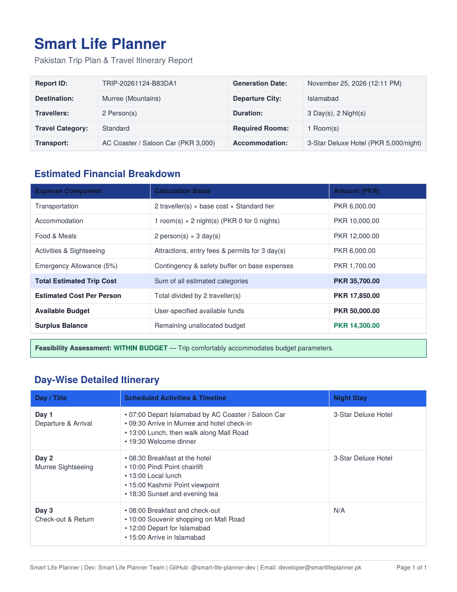
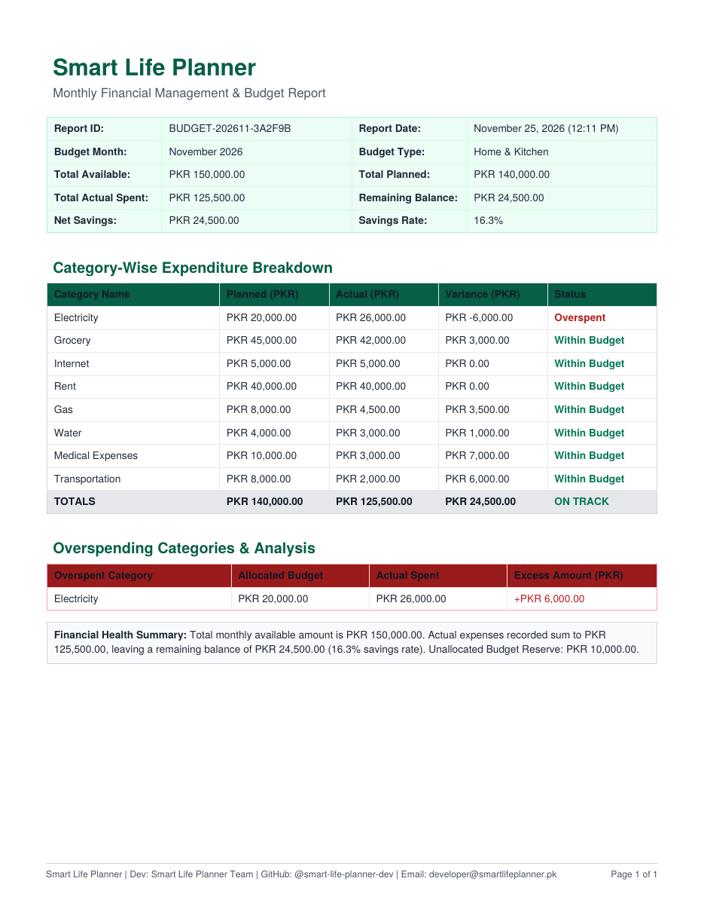

<p align="center"></p>
<p align="center"><a href="https://maidajaved23.github.io/python-smart-life-planner/preview.html"><b>Open the live preview page</b></a> | <a href="https://github.com/MaidaJaved23">GitHub profile</a> | <a href="https://github.com/MaidaJaved23/python-smart-life-planner">Repository</a></p>
<p align="center"><a href="https://github.com/MaidaJaved23/python-smart-life-planner"></a> <a href="https://github.com/MaidaJaved23"></a></p>
<p align="center"></p>
<p align="center">    </p>
<p align="center"><a href="https://maidajaved23.github.io/python-smart-life-planner/preview.html"></a></p>

##  Smart Life Planner: Pakistan Trip Planner & Monthly Budget Manager

An intelligent, production-ready terminal menu-driven Python application integrating two essential lifestyle modules:
1. **Pakistan Trip Planner:** Plans and evaluates journeys across Pakistan with dynamic feasibility checking, multi-factor cost optimization, non-destructive parameter modification, and adaptive day-wise itineraries.
2. **Monthly Budget Manager:** Tracks household and personal finances, monitors planned allocations vs. actual expenditures, detects category-wise and overall overspending, computes net savings rates, and exports professional multi-page PDF financial statements.

<p align="center"></p>

##  Table of Contents
- [1. Project Overview & Problem Statement](#1-project-overview--problem-statement)
- [2. Application Architecture & Folder Structure](#2-application-architecture--folder-structure)
- [3. Module One: Pakistan Trip Planner](#3-module-one-pakistan-trip-planner)
  - [3.1 Calculation Formulas & Assumptions](#31-calculation-formulas--assumptions)
  - [3.2 Feasibility Classification & Boundaries](#32-feasibility-classification--boundaries)
  - [3.3 Intelligent Feasibility Optimization](#33-intelligent-feasibility-optimization)
  - [3.4 Dynamic Non-Destructive Trip Modification](#34-dynamic-non-destructive-trip-modification)
  - [3.5 Adaptive Day-Wise Itinerary Generation](#35-adaptive-day-wise-itinerary-generation)
- [4. Module Two: Monthly Budget Manager](#4-module-two-monthly-budget-manager)
  - [4.1 Budget Types & Category Customization](#41-budget-types--category-customization)
  - [4.2 Expense Management & Overspending Detection](#42-expense-management--overspending-detection)
  - [4.3 Financial Metrics & Savings Analysis](#43-financial-metrics--savings-analysis)
- [5. Python Concepts & Advanced Standard Library](#5-python-concepts--advanced-standard-library)
  - [5.1 Object-Oriented Programming (OOP) Classes](#51-object-oriented-programming-oop-classes)
  - [5.2 Python `collections` Module Utilization](#52-python-collections-module-utilization)
- [6. PDF Report Generation](#6-pdf-report-generation)
- [7. Installation & Execution](#7-installation--execution)
- [8. Automated Pytest Unit Testing](#8-automated-pytest-unit-testing)
- [9. Developer Configuration](#9-developer-configuration)
- [10. Sample Terminal Outputs](#10-sample-terminal-outputs)
- [11. Final Submission Checklist](#11-final-submission-checklist)
- [12. Visual Documentation](#12-visual-documentation)
- [13. PDF Report Screenshots](#13-pdf-report-screenshots)
- [14. Test Case Matrix](#14-test-case-matrix)

<p align="center"></p>

<a name="1-project-overview--problem-statement"></a>

##  1. Project Overview & Problem Statement

Travelers exploring Pakistan frequently encounter budget uncertainty due to unpredictable multi-city logistics, accommodation tiers, meal costs, and emergency buffers. Concurrently, households and individuals often struggle to monitor monthly finances across varied expense categories, leading to unintentional debt and missed savings targets.

**Smart Life Planner** addresses these dual challenges through a unified, object-oriented terminal system:
- It eliminates travel financial guesswork by computing comprehensive trip expenses based on room capacities, duration (handling zero-night day trips separately), travel category tiers, and automatic 5% emergency buffers.
- When an itinerary is unaffordable, the application executes a mathematical optimizer that calculates feasible alternatives (budget increases, reduced travelers, shortened duration, preference adjustments, or alternative destinations) without hardcoding or recommending false positives.
- It delivers personal finance discipline by recording actual expenses against planned budgets, highlighting category-level overages, and maintaining an audit history.
- After user confirmation, the system compiles publication-grade PDF reports via ReportLab with page-numbered footers displaying verified developer credentials.

<p align="center"></p>

<a name="2-application-architecture--folder-structure"></a>

##  2. Application Architecture & Folder Structure

The project strictly follows modular separation of concerns:

```text
python-smart-life-planner/
├── main.py                     # Main orchestrator (SmartLifePlanner class) & CLI menu
├── config/
│   └── developer.json          # Developer attribution (name, GitHub, email)
├── models/
│   ├── __init__.py
│   ├── destination.py          # Destination model & room capacity calculation
│   ├── trip.py                 # Trip entity, CostBreakdown & OptimizationOption namedtuples
│   ├── expense.py              # Expense entity with validation
│   └── budget.py               # Budget entity (defaultdict groupings, category management)
├── services/
│   ├── __init__.py
│   ├── trip_calculator.py      # Pure mathematical trip cost calculator
│   ├── feasibility_checker.py  # Within Budget / Exactly Budget / Over Budget diagnostics
│   ├── trip_optimizer.py       # Multi-factor alternative generator & ranking engine
│   ├── trip_planner.py         # Trip workflow coordinator & adaptive itinerary engine
│   ├── budget_manager.py       # Financial analysis, Counter frequency, deque audit
│   └── report_generator.py     # Terminal tables & formatted textual reports
├── utils/
│   ├── __init__.py
│   ├── validators.py           # Robust input validation & edge-case guards
│   ├── calculations.py         # Reusable mathematical helpers & currency formatting
│   └── data_manager.py         # Safe atomic JSON persistence & file recovery
├── pdf/
│   ├── __init__.py
│   └── pdf_generator.py        # ReportLab PDF compiler with NumberedCanvas running footer
├── data/
│   ├── destinations.json       # Seed database of 9+ Pakistan destinations
│   ├── trips.json              # Confirmed saved trip records
│   └── budgets.json            # Saved monthly budget records
├── reports/
│   └── .gitkeep                # Output directory for generated PDF reports
├── tests/
│   ├── __init__.py
│   ├── test_validators.py      # Input boundary validation tests
│   ├── test_trip_calculator.py # Trip cost math, room ceiling & zero-night tests
│   ├── test_feasibility_checker.py # Exact budget, +/- PKR 1 boundaries
│   ├── test_trip_optimizer.py  # Alternative generation & affordability guarantees
│   ├── test_trip_planner.py    # Modification cancellation & confirmed persistence
│   ├── test_budget_manager.py  # Budget creation, overspending, category management
│   ├── test_data_manager.py    # File resilience & corrupted JSON recovery
│   ├── test_pdf_generator.py   # PDF confirmation gate & developer footer tests
│   └── test_report_generator.py# Summary text & ranking table tests
├── requirements.txt            # Dependencies (pytest, reportlab)
├── .gitignore                  # Git ignore rules
└── README.md                   # Comprehensive documentation
```

<p align="center"></p>

<a name="3-module-one-pakistan-trip-planner"></a>

##  3. Module One: Pakistan Trip Planner

### 3.1 Calculation Formulas & Assumptions
Costs in `data/destinations.json` reflect realistic seasonal averages across Murree, Nathiagali, Swat, Kalam, Hunza, Skardu, Naran, Lahore, and Islamabad.

```text
1. Transportation Cost      = Base Transport Cost × Tier Multiplier × Travellers
2. Rooms Required           = ceil(Travellers ÷ Destination Room Capacity)
3. Accommodation Cost       = Base Room Cost × Tier Multiplier × Rooms Required × Nights
                              * ZERO-NIGHT RULE: If Nights == 0, Accommodation Cost = 0.00
4. Food & Dining Cost       = Base Food Cost × Tier Multiplier × Travellers × Days
5. Activities & Misc Cost   = Base Activity Cost × Tier Multiplier × Travellers × Days
6. Operational Subtotal     = Transportation + Accommodation + Food + Activities
7. Emergency Allowance      = Operational Subtotal × 5% (0.05)
8. Total Estimated Cost     = Operational Subtotal + Emergency Allowance
9. Cost Per Person          = Total Estimated Cost ÷ Travellers
10. Net Balance / Shortage  = Available Budget - Total Estimated Cost
```

#### Tier Multipliers:
- **Budget:** Transport 0.8x, Accommodation 0.7x, Food 0.8x, Activities 0.8x
- **Standard:** Transport 1.0x, Accommodation 1.0x, Food 1.0x, Activities 1.0x
- **Premium:** Transport 1.8x, Accommodation 2.0x, Food 1.5x, Activities 1.5x

### 3.2 Feasibility Classification & Boundaries
- **Within Budget:** `Total Cost < Budget` (Positive remaining surplus).
- **Exactly Within Budget:** `abs(Total Cost - Budget) < 0.01` (Exact match down to the paisa).
- **Over Budget:** `Total Cost > Budget` (Deficit detected; diagnostic breakdown activated).

### 3.3 Intelligent Feasibility Optimization
When a trip exceeds available funds, `TripOptimizer` generates **guaranteed affordable alternatives**:
1. **Increase Budget:** Calculates the exact minimum required budget and additional PKR needed (`shortage`).
2. **Reduce Travelers:** Iteratively tests traveler counts from `N - 1` down to 1; determines the maximum group size that completely fits within the budget.
3. **Reduce Duration:** Shortens days and nights (e.g. 5D/4N -> 4D/3N -> 3D/2N -> 2D/1N -> 1D/0N) until recalculated total fits the budget.
4. **Adjust Preferences:** Downgrades tiers (`Premium` -> `Standard` -> `Budget`) while preserving destination, travelers, and days.
5. **Change Destination:** Scans all other 8+ destinations at the same duration and travelers, filtering those that fit.
6. **Multi-Factor Ranking:** Alternatives are scored dynamically based on:
   $$\text{Score} = \text{Base} + (\text{Preference Match}) + \left(\frac{\text{Days Preserved}}{\text{Original Days}} \times 25\right) + \left(\frac{\text{Remaining Budget}}{\text{Total Budget}} \times 20\right)$$
   **Strict Guarantee:** Every recommended alternative has its complete cost recalculated; no unaffordable option is ever presented.

### 3.4 Dynamic Non-Destructive Trip Modification
Users can modify any combination of parameters (budget, travelers, days, nights, category, destination) without restarting the program.
- Uses `trip.clone()` to compute candidate adjustments in isolation.
- Displays a side-by-side comparison.
- **Cancellation Guarantee:** Cancelling or exiting an adjustment leaves the previous plan 100% unaltered.

### 3.5 Adaptive Day-Wise Itinerary Generation
Itineraries automatically adapt to the specific days and nights:
- **Day Trips (0 Nights):** Early departure from departure city, scenic drive, morning tea, primary landmark visit, local lunch, afternoon exploration, scenic sunset viewpoint, and same-day return journey.
- **Multi-Day Trips:** Day 1 includes departure, transit, hotel check-in, and welcome dinner; intermediate days feature authentic destination attractions (e.g., Attabad Lake, Malam Jabba, Saif-ul-Malook); final day features breakfast, check-out, souvenir shopping, and return transit.

<p align="center"></p>

<a name="4-module-two-monthly-budget-manager"></a>

##  4. Module Two: Monthly Budget Manager

### 4.1 Budget Types & Category Customization
Users select between two pre-configured template profiles:
- **Home & Kitchen:** Grocery, Electricity, Gas, Water, Internet, Rent, Kitchen Supplies, Medical Expenses, Transportation, Emergency Savings, Other Expenses.
- **Personal Finance:** Cosmetics & Personal Care, Fitness & Gym, Health & Medical, Shopping, Clothing, Food & Restaurants, Transportation, Education, Entertainment, Investments & Savings, Other Expenses.

**Custom Categories:** Users can add, update planned amounts, or remove categories at any time.

### 4.2 Expense Management & Overspending Detection
- Record actual spending entries with unique IDs, category association, amount, date (YYYY-MM-DD), and description.
- **Category Overspending:** Flagged when `Category Actual > Category Planned`.
- **Overall Overspending:** Flagged when `Total Actual > Total Available Amount`.
- Deleting a category safely remaps orphaned expenses to `Other Expenses`.

### 4.3 Financial Metrics & Savings Analysis
- **Total Planned & Actual:** Aggregated per category.
- **Unallocated Budget:** `Total Available - Total Planned`.
- **Remaining Balance:** `Total Available - Total Actual`.
- **Net Savings Rate:** $\left(\frac{\text{Remaining Balance}}{\text{Total Available}}\right) \times 100\%$.

<p align="center"></p>

<a name="5-python-concepts--advanced-standard-library"></a>

##  5. Python Concepts & Advanced Standard Library

### 5.1 Object-Oriented Programming (OOP) Classes

| Class | Module | Responsibility |
|---|---|---|
| `Destination` | `models/destination.py` | Encapsulates destination metrics, room capacities, tier multipliers, and attractions. |
| `Trip` | `models/trip.py` | Encapsulates trip configuration, immutable cost breakdown, itinerary, and cloning logic. |
| `Expense` | `models/expense.py` | Represents validated spending records with update capabilities. |
| `Budget` | `models/budget.py` | Manages monthly budget entity, category dictionaries, and expense list. |
| `TripCostCalculator` | `services/trip_calculator.py` | Computes mathematical cost components, ceiling division, and 5% contingency. |
| `TripFeasibilityChecker` | `services/feasibility_checker.py` | Classifies budget feasibility and formats diagnostic shortage explanations. |
| `TripOptimizer` | `services/trip_optimizer.py` | Computes mathematically verified alternative travel options. |
| `TripPlanner` | `services/trip_planner.py` | Coordinates trip planning lifecycle, modification rollback, and itinerary generation. |
| `MonthlyBudgetManager` | `services/budget_manager.py` | Manages budgets, expenses, category variance, and overspending analysis. |
| `ReportGenerator` | `services/report_generator.py` | Formats clean ASCII terminal tables and comparative rankings. |
| `NumberedCanvas` | `pdf/pdf_generator.py` | Custom ReportLab two-pass canvas rendering total page numbers and developer footer. |
| `PDFReportGenerator` | `pdf/pdf_generator.py` | Assembles professional PDF documents for confirmed trips and monthly reports. |
| `DataManager` | `utils/data_manager.py` | Provides atomic JSON reads/writes, corrupted file recovery, and directory management. |
| `SmartLifePlanner` | `main.py` | Main CLI driver managing terminal menus and interactive user sessions. |

### 5.2 Python `collections` Module Utilization

The application leverages four distinct structures from Python's standard `collections` module:
1. **`namedtuple` (`models/trip.py`, `utils/validators.py`):**
   - `CostBreakdown`: Provides structured, immutable records for transportation, accommodation, food, activities, emergency allowance, total cost, cost per person, and remaining balance.
   - `OptimizationOption`: Encapsulates alternative strategies, titles, modified trip clones, and calculated scores.
   - `ValidationResult`: Encapsulates `(is_valid, value, error_message)` triples for robust error handling.
2. **`defaultdict` (`models/budget.py`, `services/budget_manager.py`):**
   - Automatically groups actual expenses by category without manual dictionary key checks, ensuring zero-allocation categories default to `0.0`.
3. **`Counter` (`services/budget_manager.py`):**
   - Tallies expense transaction counts across categories to detect high-frequency spending areas and identify the most active expense category.
4. **`deque` (`services/trip_planner.py`, `services/budget_manager.py`):**
   - Implements bounded-size audit history logs (`maxlen=25` and `maxlen=30`) tracking modifications, state changes, and rollbacks for accountability.

<p align="center"></p>

<a name="6-pdf-report-generation"></a>

##  6. PDF Report Generation

PDF reports are compiled using Python's **ReportLab** library and adhere to strict formatting standards:
- **Confirmation Gate:** PDF compilation is only allowed *after* the user reviews and confirms the final trip plan or monthly budget. Unconfirmed plans raise an explicit error.
- **Running Developer Footer:** Drawn via `NumberedCanvas` at the bottom of *every page*:
  ```text
  Smart Life Planner | Dev: Smart Life Planner Team | GitHub: @smart-life-planner-dev | Email: developer@smartlifeplanner.pk  Page X of Y
  ```
- **Collisions & Overwrites:** Filenames use timestamps and auto-incrementing counters (`trip_report_<trip_id>_<timestamp>.pdf`), preventing report overwriting.

<p align="center"></p>

<a name="7-installation--execution"></a>

##  7. Installation & Execution

### Prerequisites
- Python 3.10 or higher (Python 3.14+ fully supported).
- Pip package manager.

### 1. Clone the Repository
```bash
git clone https://github.com/<your-username>/python-smart-life-planner.git
cd python-smart-life-planner
```

### 2. Install Dependencies
```bash
pip install -r requirements.txt
```

### 3. Launch the Application
```bash
python main.py
```

<p align="center"></p>

<a name="8-automated-pytest-unit-testing"></a>

##  8. Automated Pytest Unit Testing

The project includes an automated test suite comprising **104 test cases** with 100% pass rate covering calculations, edge cases, boundaries, validations, persistence, and PDF creation.

### Run All Tests:
```bash
pytest -v
```

### Test Coverage Highlights:
- **`test_trip_calculator.py`**: Standard multi-day calculations, room capacity ceiling division (3 persons -> 2 rooms), zero-night accommodation rule (Nights=0 -> PKR 0.00), emergency allowance impact.
- **`test_feasibility_checker.py`**: Exact budget match, PKR 1 above budget, PKR 1 below budget, diagnostic explanation accuracy.
- **`test_trip_optimizer.py`**: Budget increase calculations, traveler reduction, duration reduction, tier downgrade, alternative destinations, and strict affordability verification (zero false positives).
- **`test_trip_planner.py`**: Creation of plans, adaptive zero-night itineraries, non-destructive modification cancellation, and confirmed persistence.
- **`test_budget_manager.py`**: Budget creation, zero/negative rejection, custom categories, duplicate prevention, expense recording/updating/deletion, category and overall overspending.
- **`test_validators.py`**: Numerical parsing, string stripping, bounds checking, day/night combinations (nights > days rejected), email and date validation.
- **`test_data_manager.py`**: Directory auto-creation, missing files, corrupted JSON recovery, atomic file writes.
- **`test_pdf_generator.py`**: Unconfirmed trip rejection, PDF compilation, developer footer presence, unique filename generation.
- **`test_report_generator.py`**: Textual summary generation, ranked alternatives tables, overspending alert formatting.

### Test Results Summary:
```text
============================= test session starts =============================
platform win32 -- Python 3.14.4, pytest-9.2.0, pluggy-1.7.0
rootdir: python-smart-life-planner
collected 104 items

tests/test_budget_manager.py ...........                                [ 10%]
tests/test_data_manager.py ......                                       [ 16%]
tests/test_feasibility_checker.py .....                                 [ 21%]
tests/test_pdf_generator.py ....                                        [ 25%]
tests/test_report_generator.py ...                                      [ 27%]
tests/test_trip_calculator.py ........                                  [ 35%]
tests/test_trip_optimizer.py .......                                    [ 42%]
tests/test_trip_planner.py .....                                        [ 47%]
tests/test_validators.py .............................................. [100%]

============================= 104 passed in 1.49s =============================
```

<p align="center"></p>

<a name="9-developer-configuration"></a>

##  9. Developer Configuration

Developer information is loaded from `config/developer.json` and rendered in the footer of every generated PDF page:

```json
{
  "developer_name": "Smart Life Planner Team",
  "github_username": "smart-life-planner-dev",
  "email": "developer@smartlifeplanner.pk"
}
```

Students can update this directly in `config/developer.json` or interactively via **Option 4: Developer Information** in the main menu.

<p align="center"></p>

<a name="10-sample-terminal-outputs"></a>

##  10. Sample Terminal Outputs

### Sample 1: Trip Plan Summary (Standard Category, Within Budget)
```text
========================================================================
          PAKISTAN TRIP PLAN - MURREE
========================================================================
Trip ID          : TRIP-20261124-B83DA1
Departure City   : Islamabad
Destination      : Murree (Category: Mountains)
Travellers       : 2 person(s)
Duration         : 3 Day(s), 2 Night(s)
Travel Category  : Standard
Transport Choice : AC Coaster / Saloon Car (PKR 3,000)
Hotel Selection  : 3-Star Deluxe Hotel (PKR 5,000/night)
Required Rooms   : 1 room(s)
------------------------------------------------------------------------
ESTIMATED FINANCIAL BREAKDOWN (PKR):
  1. Transportation Cost      :     PKR 6,000.00
  2. Accommodation Cost       :    PKR 10,000.00
  3. Food & Dining Cost       :    PKR 12,000.00
  4. Activities & Sightseeing :     PKR 6,000.00
  5. Emergency Allowance (5%) :     PKR 1,700.00
------------------------------------------------------------------------
  TOTAL ESTIMATED COST        :    PKR 35,700.00
  Cost Per Person             :    PKR 17,850.00
  Available Budget            :    PKR 50,000.00
  Surplus Remaining Balance   :    PKR 14,300.00
------------------------------------------------------------------------
FEASIBILITY STATUS: WITHIN BUDGET
========================================================================
```

### Sample 2: Intelligent Optimization Table (Over-Budget Alternative Ranking)
```text
========================================================================================
               RANKED FEASIBLE TRIP ALTERNATIVES (WITHIN BUDGET)
========================================================================================
Rank  | Option Title                       | Total Cost     | Surplus        | Score 
----------------------------------------------------------------------------------------
1     | Switch to Budget Travel Category   | PKR 24,990.00  | PKR 5,010.00   | 55.0  
      Details: Change travel tier from Standard to Budget while keeping destination, 
      travellers, and duration intact. Recalculated cost: PKR 24,990.00.
----------------------------------------------------------------------------------------
2     | Change Destination to Swat         | PKR 28,350.00  | PKR 1,650.00   | 56.1  
      Details: Travel to Swat (Mountains, Khyber Pakhtunkhwa) with 2 travellers for 3 days.
----------------------------------------------------------------------------------------
3     | Reduce Duration to 2 days, 1 night | PKR 24,150.00  | PKR 5,850.00   | 34.9  
      Details: Shorten trip to 2 days and 1 night for all 2 travellers.
----------------------------------------------------------------------------------------
```

### Sample 3: Monthly Budget Overspending Warning
```text
==================================================================================
        MONTHLY FINANCIAL REPORT - NOVEMBER 2026 (HOME & KITCHEN)
==================================================================================
Budget ID           : BUDGET-202611-3A2F9B
Total Income/Budget : PKR 150,000.00
Total Planned       : PKR 140,000.00
Unallocated Amount  : PKR 10,000.00
Total Actual Spent  : PKR 125,500.00
Remaining Balance   : PKR 24,500.00
Savings Percentage  : 16.3%
----------------------------------------------------------------------------------
Category                     |      Planned |       Actual |   Difference | Status    
----------------------------------------------------------------------------------
Electricity                  | PKR 20,000.00 | PKR 26,000.00 | PKR -6,000.00 | Overspent 
Grocery                      | PKR 45,000.00 | PKR 42,000.00 |  PKR 3,000.00 | Within Budget
Internet                     |  PKR 5,000.00 |  PKR 5,000.00 |      PKR 0.00 | Within Budget
----------------------------------------------------------------------------------
WARNING: OVERSPENT CATEGORIES DETECTED:
  ! Electricity: Planned PKR 20,000.00, Actual PKR 26,000.00 -> Overspent by PKR 6,000.00
==================================================================================
```

<p align="center"></p>

<a name="11-final-submission-checklist"></a>

##  11. Final Submission Checklist

- [x] **Pakistan Trip Planner Module:** All inputs validated; room capacity ceiling division; zero-night trips handled with PKR 0.00 accommodation; dynamic tier multipliers (Budget, Standard, Premium); emergency allowance calculated; day-wise itinerary generated.
- [x] **Trip Feasibility & Optimization:** Within Budget, Exactly Budget, and Over Budget classified; diagnostic shortage driver analysis; 6 optimization dimensions calculated; strictly verified affordable alternatives ranked.
- [x] **Dynamic Trip Modification:** Modify budget, travellers, duration, destination, category without restarting; review and confirm/cancel; cancel preserves original plan intact.
- [x] **Monthly Budget Manager Module:** Home & Kitchen and Personal Finance templates; custom categories; expense creation, update, and deletion; category and overall overspending detection; net savings rate.
- [x] **OOP & Python Collections:** Separate classes with distinct responsibilities; `namedtuple`, `defaultdict`, `Counter`, and `deque` meaningfully applied.
- [x] **Data Persistence:** JSON files for destinations, confirmed trips, budgets, and developer config; corrupted JSON safely handled.
- [x] **PDF Report Generation:** Professional ReportLab output for trips and budgets; confirmation gate enforced; running footer with developer name, GitHub username, email, and page counts on every page.
- [x] **Automated Pytest Suite:** 104 comprehensive unit and boundary tests implemented and passing.
- [x] **Version Control:** Clean repository structure, `.gitignore`, `requirements.txt`, and meaningful git commit history.

<a name="12-visual-documentation"></a>

##  12. Visual Documentation

Every graphic is an animated, resolution-independent SVG. See them all in the [live preview](https://maidajaved23.github.io/python-smart-life-planner/preview.html).

### Manual planning vs Smart Life Planner
<p align="center"></p>

### Module overview
<p align="center"></p>

### Charts
<p align="center"></p>

<p align="center"></p>

<p align="center"></p>

<p align="center"></p>

### Architecture design
<p align="center"></p>

### Entity relationship diagram (ERD)
<p align="center"></p>

### UML class diagram
<p align="center"></p>

### System design flow
<p align="center"></p>


<a name="13-pdf-report-screenshots"></a>

##  13. PDF Report Screenshots

Generated by `pdf/pdf_generator.py` from sample data (Murree trip and November budget). Page 1 of each report:

<table><tr><td align="center"><b>Trip plan report</b><br/></td><td align="center"><b>Monthly budget report</b><br/></td></tr></table>

<a name="14-test-case-matrix"></a>

##  14. Test Case Matrix

Run `pytest -v`. The suite has **104 test cases** and all pass. A selection of the key cases:

| # | Test file | Scenario | Expected result | Status |
|---|---|---|---|---|
| TC-01 | `test_trip_calculator.py` | 3 travellers, room capacity 2 | Rooms = 2 (ceiling division) | Pass |
| TC-02 | `test_trip_calculator.py` | Nights = 0 | Accommodation = PKR 0.00 | Pass |
| TC-03 | `test_trip_calculator.py` | Base subtotal PKR 34,000 | Emergency allowance = 5% = PKR 1,700 | Pass |
| TC-04 | `test_feasibility_checker.py` | Cost equals budget | Status: exactly within budget | Pass |
| TC-05 | `test_feasibility_checker.py` | Budget short by PKR 1 | Status: over budget, shortage PKR 1 | Pass |
| TC-06 | `test_feasibility_checker.py` | Budget above cost by PKR 1 | Status: within budget | Pass |
| TC-07 | `test_trip_optimizer.py` | Every generated alternative | Re-costed as affordable (0 false positives) | Pass |
| TC-08 | `test_trip_planner.py` | Modify a plan, then cancel | Original plan stays unchanged | Pass |
| TC-09 | `test_trip_planner.py` | Confirm a plan | Persisted to trips JSON | Pass |
| TC-10 | `test_budget_manager.py` | Zero or negative budget | Rejected with a clear error | Pass |
| TC-11 | `test_budget_manager.py` | Duplicate category name | Rejected | Pass |
| TC-12 | `test_budget_manager.py` | Electricity actual 26,000 vs planned 20,000 | Flagged as overspent by PKR 6,000 | Pass |
| TC-13 | `test_validators.py` | Nights greater than days | Rejected | Pass |
| TC-14 | `test_validators.py` | Invalid email or date | Rejected with message | Pass |
| TC-15 | `test_data_manager.py` | Corrupted JSON file | Recovered, no crash | Pass |
| TC-16 | `test_data_manager.py` | Missing data directory | Created automatically | Pass |
| TC-17 | `test_pdf_generator.py` | Unconfirmed trip | ValueError, no PDF written | Pass |
| TC-18 | `test_pdf_generator.py` | Two PDFs in the same second | Unique filenames, no overwrite | Pass |
| TC-19 | `test_report_generator.py` | Ranked alternatives table | Sorted best score first | Pass |

<p align="center"></p>

<p align="center"></p>

<p align="center"></p>
<p align="center"><a href="https://github.com/MaidaJaved23"></a> <a href="https://github.com/MaidaJaved23/python-smart-life-planner"></a></p>
<p align="center"><a href="https://github.com/MaidaJaved23/python-smart-life-planner"></a></p>
